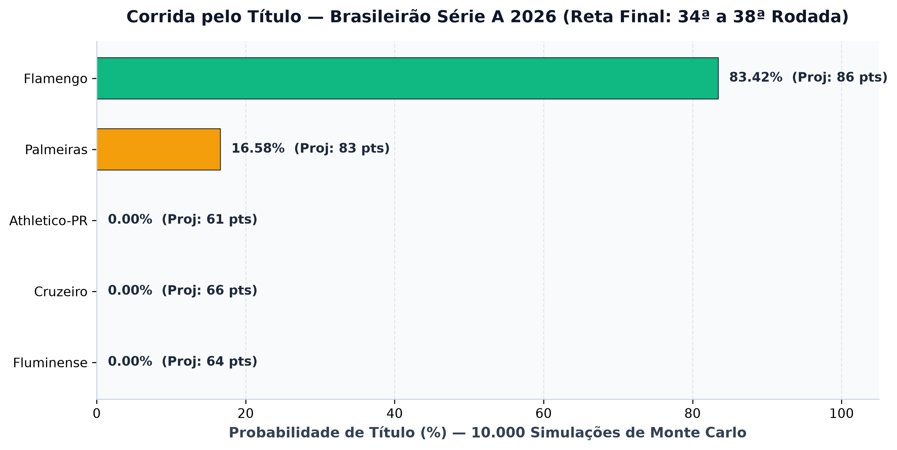
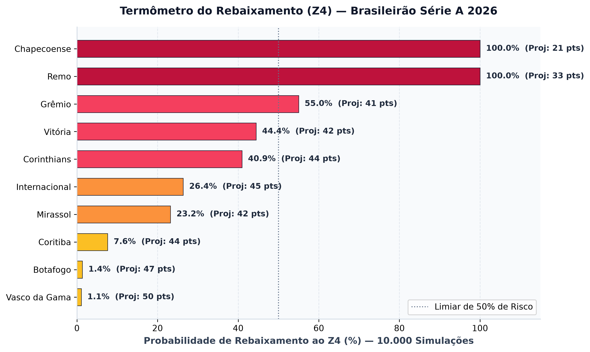
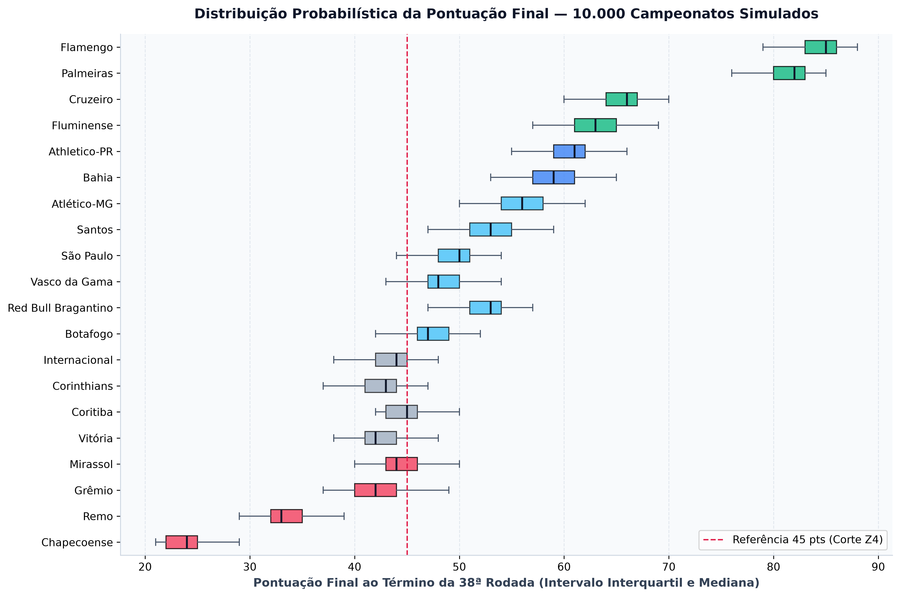
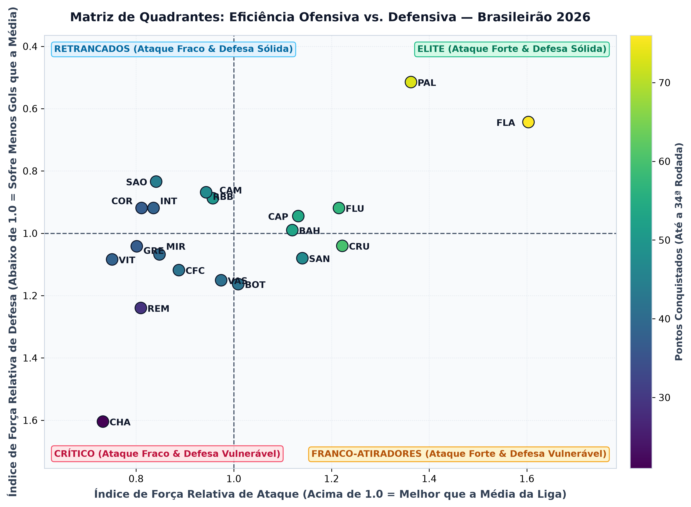

# 🏆 Preditor do Brasileirão Série A 2026 — Poisson & Monte Carlo

Simulador estatístico e produto de dados de ponta a ponta construído para modelar, prever e simular a reta final do **Campeonato Brasileiro Série A 2026**, integrando **Engenharia de Dados**, **Ciência de Dados** e **Análise de Dados & Business Intelligence (BI)**.

---

## 🎯 Visão Geral do Projeto

Quando restam 41 partidas para o encerramento de um campeonato de pontos corridos, o espaço amostral de combinações de resultados possíveis ($3^{41} \approx 3,64 \times 10^{19}$) torna inviável qualquer solução combinatória exata por força bruta.

Este projeto resolve esse problema combinando **modelagem probabilística paramétrica (Distribuição de Poisson)** com **inferência estocástica vetorizada (Simulação de Monte Carlo — 10.000 iterações)**, entregando tanto um estudo analítico reprodutível em Jupyter Notebook quanto uma **aplicação web interativa** inspirada no simulador do *ge.globo*.

### As Três Frentes Integradas
1. **Engenharia de Dados (`src/data_engineering/`)**:
   - Pipeline ETL em **Pandas** que ingere o histórico real de partidas (`data/raw/BRA.csv`), descarta colunas de cotações de casas de apostas (*odds*) diretamente na leitura de memória (`usecols`), padroniza nomenclaturas, siglas e estádios sede dos 20 clubes e estrutura o calendário restante (`data/raw/jogos_restantes.csv`).
   - Cálculo sem arredondamento precoce (`float64`) das **Médias Gerais da Liga** ($\mu_{\text{mandante}}$ e $\mu_{\text{visitante}}$) e dos **Índices de Força Relativa de Ataque e Defesa** ponderados por mando de campo.
2. **Ciência de Dados (`src/data_science/`)**:
   - **Previsão de Partida Única (Distribuição de Poisson)**: Estima a expectativa de gols ($\lambda_{\text{mandante}}, \lambda_{\text{visitante}}$) de cada confronto e constrói a matriz de probabilidades conjuntas $9 \times 9$ ($0$ a $8$ gols) para determinar o **Placar Mais Provável** (moda da distribuição) e as probabilidades agregadas de Vitória, Empate e Derrota.
   - **Projeção do Campeonato (Simulação de Monte Carlo)**: Simula de forma 100% vetorizada em **NumPy** o desfecho do campeonato **10.000 vezes** em menos de $0,1\text{s}$, aplicando os 4 critérios oficiais de desempate da CBF (*Pontos > Vitórias > Saldo de Gols > Gols Pró*) e respeitando eventuais palpites travados manualmente pelo usuário.
3. **Análise de Dados, BI & Data Product (`src/bi_analytics/`, `notebooks/` e `web/`)**:
   - Geração automatizada de **4 gráficos executivos** em alta resolução (`300 DPI`) com **Matplotlib** e **Seaborn**.
   - **Simulador Web Interativo (Flask + JS)**: Interface completa com navegação da 1ª à 38ª rodada, preenchimento manual por teclado (`Tab`), autopreenchimento via Poisson, sorteio estocástico dinâmico e **Coluna Inteligente de Probabilidades**.

---

## 📐 Fundamentação Matemática

### 1. Índices de Força Relativa (Ponderados por Mando de Campo)
Seja $\mu_{\text{mandante}}$ a média de gols marcados pelos mandantes na liga e $\mu_{\text{visitante}}$ a média de gols marcados pelos visitantes. Para cada clube $i$, calculamos quatro parâmetros estruturais independentes:

$$\text{ForçaAtaqueMandante}_i = \frac{\text{Gols Pró em Casa}_i / \text{Jogos em Casa}_i}{\mu_{\text{mandante}}}, \quad \text{ForçaDefesaMandante}_i = \frac{\text{Gols Sofridos em Casa}_i / \text{Jogos em Casa}_i}{\mu_{\text{visitante}}}$$

$$\text{ForçaAtaqueVisitante}_j = \frac{\text{Gols Pró Fora}_j / \text{Jogos Fora}_j}{\mu_{\text{visitante}}}, \quad \text{ForçaDefesaVisitante}_j = \frac{\text{Gols Sofridos Fora}_j / \text{Jogos Fora}_j}{\mu_{\text{mandante}}}$$

### 2. Expectativa de Gols ($\lambda$) e Distribuição de Poisson
Em um confronto entre o Mandante $i$ e o Visitante $j$, a taxa esperada de gols ($\lambda$) cruza a eficiência ofensiva de uma equipe com a vulnerabilidade defensiva da outra:

$$\lambda_{\text{mandante}} = \text{ForçaAtaqueMandante}_i \times \text{ForçaDefesaVisitante}_j \times \mu_{\text{mandante}}$$

$$\lambda_{\text{visitante}} = \text{ForçaAtaqueVisitante}_j \times \text{ForçaDefesaMandante}_i \times \mu_{\text{visitante}}$$

A probabilidade de cada placar exato $(x, y)$ para $x, y \in \{0, 1, \dots, 8\}$ é dada por:

$$P(\text{Mandante} = x, \text{Visitante} = y) = \left( \frac{\lambda_{\text{mandante}}^x e^{-\lambda_{\text{mandante}}}}{x!} \right) \times \left( \frac{\lambda_{\text{visitante}}^y e^{-\lambda_{\text{visitante}}}}{y!} \right)$$

### 3. Simulação de Monte Carlo (Lei dos Grandes Números)
Em cada uma das $N = 10.000$ simulações, os gols dos jogos em aberto são sorteados estocasticamente segundo $X \sim \text{Poisson}(\lambda_{\text{mandante}})$ e $Y \sim \text{Poisson}(\lambda_{\text{visitante}})$. Pela Lei dos Grandes Números, a frequência relativa com que cada clube termina na posição $p \in \{1, \dots, 20\}$ converge para a probabilidade real de classificação:
- **Título**: 1º colocado
- **Libertadores (G6)**: 1º ao 6º colocado (G4 direto + Pré-Libertadores em 5º e 6º)
- **Sul-Americana**: 7º ao 12º colocado
- **Rebaixamento (Z4)**: 17º ao 20º colocado

---

## 📊 Visualizações Executivas de BI (Após a 34ª Rodada — 339/380 Jogos)

### 1. Corrida pelo Título


### 2. Termômetro do Rebaixamento (Z4)


### 3. Distribuição Probabilística da Pontuação Final (10.000 Simulações)


### 4. Matriz de Quadrantes: Eficiência Ofensiva vs. Defensiva


---

## 🗂️ Arquitetura de Diretórios

```text
brasileirao-predictor-2026/
├── README.md                         # Documentação principal do portfólio
├── requirements.txt                  # Dependências do ambiente Python
├── data/
│   ├── raw/
│   │   ├── BRA.csv                   # Histórico bruto de partidas realizadas (339 jogos)
│   │   └── jogos_restantes.csv       # Calendário oficial dos confrontos pendentes (41 jogos)
│   └── processed/                    # Artefatos limpos exportados pelo ETL e figuras (300 DPI)
├── src/
│   ├── data_engineering/
│   │   ├── clubes.py                 # Dicionário mestre dos 20 clubes (Nome, Sigla, Estádio)
│   │   └── etl.py                    # Pipeline ETL, Tabela Oficial e Forças Relativas
│   ├── data_science/
│   │   ├── poisson.py                # Motor de Poisson (matriz 9x9, lambdas e placar mais provável)
│   │   └── monte_carlo.py            # Motor vetorizado de Monte Carlo (10.000 iterações)
│   └── bi_analytics/
│       └── graficos.py               # Geração dos 4 gráficos executivos com Matplotlib/Seaborn
├── notebooks/
│   └── simulador_brasileirao.ipynb   # Caderno Jupyter didático e executado passo a passo
├── web/                              # Aplicação Web Interativa (Flask)
│   ├── app.py                        # Servidor backend e rotas de simulação (/api/estado, /api/simular)
│   ├── static/                       # CSS, JS e escudos oficiais dos 20 clubes
│   └── templates/
│       └── index.html                # Interface principal do Preditor do Brasileirão 2026
└── tests/
    └── test_simulador.py             # Suíte de testes unitários e de integração
```

---

## 🚀 Como Executar o Projeto

### 1. Configurar o Ambiente Virtual e Dependências
```bash
python3 -m venv .venv
source .venv/bin/activate
pip install -r requirements.txt
```

### 2. Executar o Pipeline de Engenharia de Dados (ETL) e Gráficos de BI
```bash
python -m src.data_engineering.etl
python -m src.bi_analytics.graficos
```

### 3. Executar a Suíte de Testes Automatizados
```bash
python -m unittest discover -s tests -v
```

### 4. Iniciar o Simulador Web Interativo
```bash
python -m web.app
```
Acesse no navegador: **`http://127.0.0.1:5000`**

---

## 👤 Autor

**Henrique Mendes Elias**  
Estudante de Graduação — **Universidade de Brasília (UnB)**
